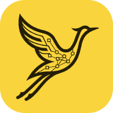

<p align="center">
  
</p>

<h1 align="center">Koonj</h1>

<p align="center">
  <strong>Faithful messenger carrying things across vast distances and reliably returning home</strong>
</p>

<p align="center">
  <a href="LICENSE"></a>
  
  
  
  <a href="https://sonarcloud.io/project/overview?id=atmenterprise_koonj"></a>
</p>

<p align="center">
  Developed and maintained by <a href="https://www.appsthatmatter.uk"><strong>Apps That Matter</strong></a>
</p>

---

## Overview

**Koonj** is an open-source, project-scoped data catalog, explorer, and tiered storage archival platform. It enables organizations to scan, catalog, archive, and transparently recall files across local/NAS mounts and S3-compatible object storage (Amazon S3, MinIO, Scality, RustFS, and LocalStack) with full lineage, checksum verification, and role-based access control.

## Key Features

- **Unified Storage Catalog & Explorer:** Scan mounted directories and object storage buckets, browse hierarchical inventories, inspect file lineage and checksums, and classify data by configurable `HOT`, `WARM`, and `COLD` temperature thresholds.
- **Distributed Archive & Recall Workers:** PostgreSQL-backed path reservations and RabbitMQ-dispatched transfer workers with pause, stop, resume, retry, and cold-storage (Glacier) restore handling.
- **Transparent FUSE & Samba Recall:** Linux FUSE gateway with an optional Samba sidecar (`vfs_offline`) allowing Windows File Explorer, macOS Finder, and Linux file managers to open archived files on demand without interactive re-authentication.
- **Project Workspaces & Security:** Multi-project isolation, email invitations, Keycloak OIDC/SAML/social authentication (`KOONJ_ADMIN`, `KOONJ_OPERATOR`, `KOONJ_VIEWER`), and encrypted credential storage via AWS KMS, local wrapping keys, AWS Secrets Manager, or customer IAM role assumption.
- **Notifications, Alerts & Observability:** Durable outbox + RabbitMQ notification worker supporting SMTP, Slack, Microsoft Teams, and HMAC-signed webhooks, alongside quota/license monitoring and OpenObserve OTLP logs, metrics, and traces.
- **MCP Server Integration:** Project-scoped Model Context Protocol (MCP) SSE server with Personal Access Tokens for Claude Desktop, Cursor, Windsurf, and custom Python/LangChain agents.

## Architecture & Modules

| Module / Directory | Technology | Purpose |
| --- | --- | --- |
| `koonj-server` | Spring Boot 3.5 / Java 21 | REST API, catalog management, transfer admission, and distributed transfer worker |
| `koonj-ui` | React 19 / TypeScript / Vite | Web console served via Nginx in production |
| `koonj-fuse` | Java 21 / FUSE | Linux FUSE gateway for transparent on-demand recall |
| `koonj-notification-worker` | Spring Boot 3.5 / Java 21 | RabbitMQ-backed SMTP and webhook notification delivery |
| `koonj-notification-model` | Java 21 | Shared notification domain models |
| `koonj-assembly` | Maven Assembly | Packages the `docker/` and `on-premise/` deployment ZIP |
| `deploy` | Docker Compose / SQL / Nginx | Compose stacks, PostgreSQL migrations, Keycloak realm templates, and proxy configs |

**External Dependencies:** PostgreSQL 15+, Keycloak 24+, and RabbitMQ 4.2.

## Quick Start

### Build the Deployment Bundle

Requires JDK 21+, Maven 3.9+, and Node.js 22.12+ with npm:

```sh
mvn -pl koonj-assembly -am clean package
```

This produces `koonj-assembly/target/koonj-<version>-deployment.zip` containing both `docker/` and `on-premise/` distributions.

### Run with Docker

1. Extract the deployment ZIP and enter `docker/`.
2. Copy `.env.example` to `.env` and configure your database, RabbitMQ, Keycloak, and storage mount settings.
3. Start the stack:

   ```sh
   docker compose up -d --build --wait
   ```

For full configuration, on-premise installation, scaling, and local development instructions, see the [Deployment Guide](docs/guide/DEPLOYMENT-GUIDE.md).

## Documentation

- **[Deployment Guide](docs/guide/DEPLOYMENT-GUIDE.md)** — Complete architecture, Docker & on-premise deployment, local development stack, distributed transfer workers, storage authentication, Keycloak, notifications, observability, and MCP integration.
- **[FUSE & Samba Integration Guide](docs/guide/FUSE-GUIDE.md)** — Transparent recall gateway setup on Linux with optional SMB export for Windows, macOS, and Linux clients.
- **[Koonj UI Guide](koonj-ui/README.md)** — Frontend development setup, tests, and source layout.

## Code Quality

- [SonarCloud Project Overview](https://sonarcloud.io/project/overview?id=atmenterprise_koonj)

## Contributing

Contributions are welcome! Please read [CONTRIBUTING.md](CONTRIBUTING.md) for guidelines on local setup, coding conventions, testing, and submitting pull requests.

## License

Copyright © 2026 [Apps That Matter](https://www.appsthatmatter.uk).

Licensed under the **Apache License, Version 2.0**. See [LICENSE](LICENSE) for the full license text.
